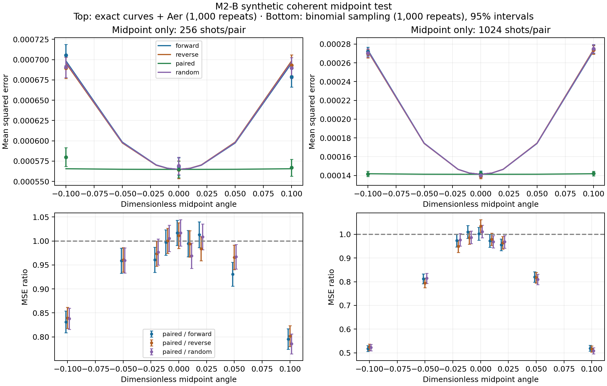
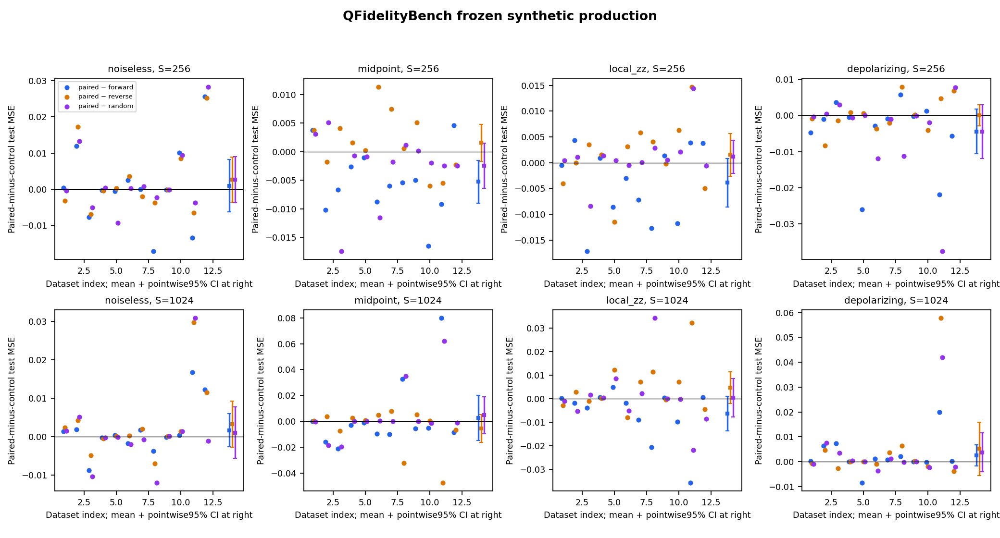

# QFidelityBench

### Two-qubit quantum fidelity estimation: noise, measurement direction and predictive utility

**Project developer: Başak Ekinci · Independent research**

A scientific research portfolio examining a practical question: **when does averaging forward and reverse quantum fidelity measurements improve kernel estimation, and does that improvement help prediction?**

This publicly available repository contains a verified two-qubit demonstration, compact scientific results, mathematical definitions and selected figures. It is a research artifact, not a general-purpose benchmarking library.

**Main finding: conditional kernel-estimation improvements did not translate into a statistically significant downstream KRR advantage after the planned Holm multiple-testing correction.** These conclusions come from distinct experiments: historical fixed-geometry kernel estimation and a frozen 12-dataset prediction study.

## Main findings

- **Conditional kernel-estimation improvement.** In selected synthetic asymmetric coherent-noise models, paired measurements reduced average kernel error at equal total shots. For the historical midpoint +0.10-radian case at 1,024 shots, actual Aer runs gave paired/forward MSE ratio **0.5171**, with pointwise approximate 95% Monte Carlo interval **[0.5046, 0.5297]**. This is the historical fixed-geometry Aer experiment: 1,000 repetitions of a fixed 28-pair set. Its Monte Carlo interval is not an interval for the separate 12-dataset KRR production analysis.
- **No significant downstream KRR advantage.** The frozen experiment used 12 independent synthetic datasets, 100 shot repetitions per setting, four conditions and two shot budgets. None of 24 primary comparisons was significant after the planned Holm correction, and none met the predefined practical-benefit criterion. Its inference averages repetitions within each dataset first (12 independent units, df=11).
- **Equal shots are not equal execution cost.** Paired estimation uses two circuit executions, each with half the shots. Hardware latency and hardware advantage were not measured.

The noiseless and depolarizing conditions are structural negative controls under the specified symmetric models: their expected forward/reverse probabilities agree, while independent finite-shot estimates can differ. See the [control assumptions](docs/METHODS.md#structural-negative-controls) and [CSV reading guide](docs/RESULTS.md#reading-resultskernel_comparisonscsv).

These findings do not establish universal error mitigation, quantum advantage, algorithmic novelty or equivalence between estimators. Lower kernel error alone does not establish better predictions or PSD behavior.



*Historical simulator results, copied unchanged. The panels distinguish NumPy-generated binomial samples from actual Aer measurements; error bars are pointwise Monte Carlo uncertainty, not dataset-level generalization bounds.*



*Frozen KRR results: each point is a dataset mean over 100 shot repetitions. Negative paired-minus-control differences favor paired. Intervals at right are pointwise 95% t intervals, not simultaneous Holm-adjusted intervals.*

## Run the small demonstration

See [reproducibility instructions](docs/REPRODUCIBILITY.md) for the tested environment and installation limitations.

```sh
python demo.py
python -m unittest discover -s tests -v
```

The demonstration replays archived actual Aer outcome counts for the first synthetic pair and first repetition in the noiseless and midpoint-error cases. It recomputes exact probabilities using verified functions and checks all four equal-budget estimates. It does **not** generate new measurement samples or rerun the production experiment.

The selected noisy repetition actually favors a fixed direction over paired. It is retained because the example was chosen by index, not performance. One repetition cannot demonstrate average superiority.

## Scientific contents

| Artifact | Purpose |
|---|---|
| [Methods](docs/METHODS.md) | Circuit ordering, noise, estimators, KRR and inference |
| [Results and limitations](docs/RESULTS.md) | Conditional kernel findings and the downstream null result |
| `archived_example.json` | Minimal synthetic example and archived full outcome counts |
| `vendor/` | Byte-identical copies of verified research functions |
| `results/kernel_comparisons.csv` | Historical comparisons, with engine and condition labels |
| `results/krr_statistics.json` | All 24 frozen comparisons, dataset means and shot variability |
| `results/provenance.json` | Original artifact paths, baseline identifier and hashes |
| `source_manifest.json` | Copied source provenance and hashes |
| `MANIFEST.sha256` | Public file checksums, excluding itself |

The completed scientific baseline is `60b4a81`. This portfolio deliberately excludes the full production archive and historical Git objects. Replaying the example and inspecting aggregate evidence is supported; reproducing the entire production experiment from this compact portfolio alone is not.

## Scope and licensing

The implemented scope is a fixed two-qubit research workflow. A reusable API, multi-qubit extension, hardware validation and external benchmark integration are not implemented here. A future reusable software package is separate from this completed two-qubit research demonstration.

Başak Ekinci developed QFidelityBench as an independent research project with AI-assisted coding support. AI tools assisted with implementation, debugging, test preparation and documentation. This acknowledgement does not identify AI tools as project authors or imply independent scientific endorsement. The preserved tests and numerical checks document validation; AI assistance alone is not evidence of correctness.

Copyright 2026 Başak Ekinci. QFidelityBench is licensed under the [Apache License, Version 2.0](LICENSE). The research portfolio is publicly available at [github.com/ekincibasak/qfidelitybench](https://github.com/ekincibasak/qfidelitybench). Dependency packages retain their own licenses. See [provenance and attribution](docs/PROVENANCE.md). No institutional affiliation or maintainer endorsement is asserted.
