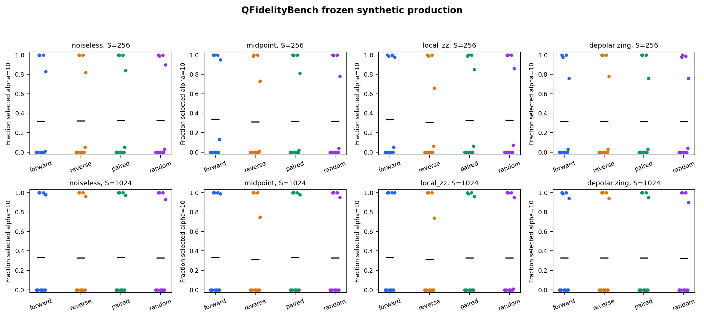

# Verified findings and interpretation

## Historical fixed-geometry Aer kernel estimation

Under isolated midpoint coherent error +0.10 at S=1024, historical actual-Aer paired/comparator MSE ratios were:

| Comparator | Ratio | Pointwise approximate 95% Monte Carlo interval |
|---|---:|---|
| Forward | 0.517149 | [0.504620,0.529678] |
| Reverse | 0.518544 | [0.505867,0.531222] |
| Random | 0.516284 | [0.503290,0.529278] |

These are 1,000 repeat measurements of 28 pairs on one fixed synthetic eight-point geometry, not independent dataset-generalization evidence. The full historical comparison table is included with engine/noise/budget labels to avoid representing this selected condition as all results. A ratio below 1 favors paired; the selected single-repetition demonstration need not favor it.

These fixed-geometry kernel-error ratios and Monte Carlo intervals belong to the historical Aer study only. The production KRR study below uses a different synthetic data design, outcome and inference unit. Its confidence intervals and multiple-testing family must not be pooled with these historical intervals.

## Frozen 12-dataset downstream KRR: null finding

All 9,600 dataset/condition/budget/repeat units completed, yielding 38,400 estimator outputs with no failed/missing primary cells. None of 24 primary tests was significant after Holm correction. The smallest adjusted p-value was approximately 0.24665. Risk ratios ranged approximately 0.98032–1.01678; none met the required ≤0.95 practical threshold. No condition/budget passed against all three controls.

This is no demonstrated downstream advantage under the frozen design. It does not establish estimator equivalence, prove absence of benefit elsewhere or support quantum advantage. All contrasts, per-dataset means and within-dataset shot standard deviations are retained in `results/krr_statistics.json`.

## Reading `results/kernel_comparisons.csv`

This table is historical kernel-estimation evidence, not the frozen production KRR results. Each row compares paired with the named `baseline` (forward, reverse or random). Use `id`, `engine`, `group`, `theta`, `shots` and `repeats` together to identify the setting.

| Engine | Repetitions | Role |
|---|---:|---|
| `aer-smoke` | 10 | Exploratory smoke/plumbing checks across conditions; not the inferential evidence for systematic improvement |
| `aer` | 1,000 | Actual Aer measurements for the historical midpoint anchors at theta=-0.10,0,+0.10 and both budgets |
| `numpy` | 1,000 | Independent NumPy binomial simulations using model probabilities; not actual Aer measurements |

`ratio` is mean paired kernel MSE divided by mean baseline kernel MSE, so values below 1 favor paired in that sample. `ratio_ci` is an approximate pointwise Monte Carlo interval. `baseline_minus_paired` is the MSE difference with the opposite sign convention: positive favors paired; `difference_ci` is its pointwise interval. `expected_ratio` and `expected_difference` come from the model probabilities, not an additional experiment. These are not Holm-adjusted KRR intervals.

Ten-repeat smoke estimates and their ratios can fluctuate substantially. Do not select an isolated low ratio, treat smoke rows as independent confirmation, pool the different engines or infer systematic benefit from one setting. Even the structural negative controls can have nonunit observed ratios despite equal expected probabilities and equal theoretical estimator MSE. Inspect model expectations, repeat counts and the uncertainty of the appropriate study together; none of these rows establishes downstream ML or hardware advantage.

## Limitations retained

- Alpha=10 was selected for 32.4375% of the quantum fits, at the upper frozen-grid boundary. No post-result grid expansion occurred.
- Two-qubit ideal fidelity Grams have rank at most 16; a 24-point training Gram is rank deficient before regularization.
- Finite-shot matrices may be indefinite. No PSD repair was applied; the algebraic ridge predictor has no asserted convex RKHS interpretation for indefinite matrices.
- Twelve independent datasets give limited precision; paired-t assumptions and fixed task/noise design constrain interpretation.
- An earlier matrix-diagnostic stage disclosed a post-result correction for sparse-event inference, retaining its original analysis. No PSD-superiority claim is made here, and no sparse-event significance result is used as headline evidence.
- No real-device run, runtime speedup, multi-qubit validation or broad task-generalization claim is supported.

This unchanged production diagnostic shows the per-dataset proportion of repetitions selecting alpha=10 by method/condition/budget. It is descriptive, not a new hypothesis test.
